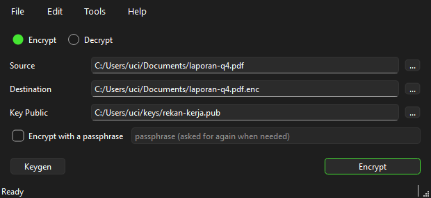
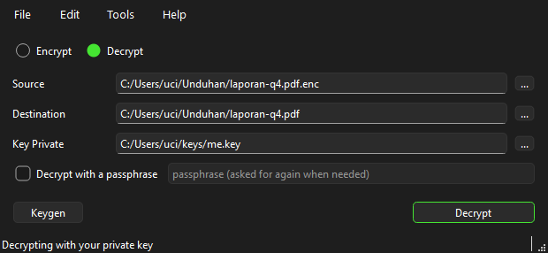
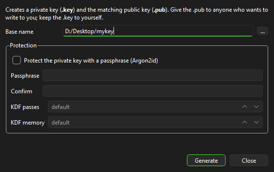
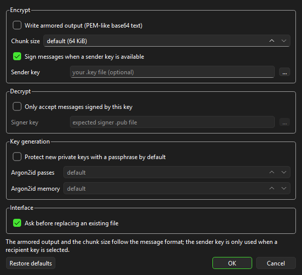
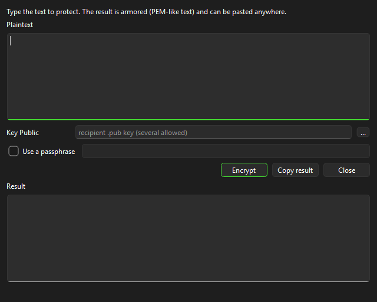
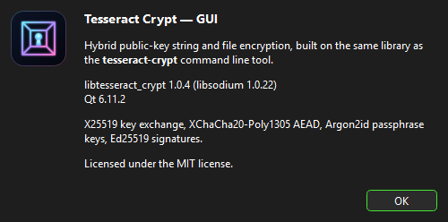

# Tesseract Crypt GUI

A **Qt6** front-end for
[`libtesseract_crypt`](https://github.com/adyoi/tesseract-crypt): every
command of the `tesseract-crypt` CLI is available as a form — file encryption
and decryption, string encryption, key generation, detached signatures,
verification, message inspection and key information.

The interface implements **no cryptography of its own**. Every operation goes
through the very same `libtesseract_crypt` the CLI uses, so files, keys and
armored text can be exchanged between the two without any conversion.

## Screenshots

| | |
| --- | --- |
|  |  |
| **Encrypt** mode | **Decrypt** mode (the *Key Private* row appears) |
|  |  |
| **Tools → Key pair** | **Edit → Options** |
|  |  |
| **Tools → Encrypt text** | **Help → About** |

The window and the program icon use the same artwork as
[`tesseract-crypt`](https://github.com/adyoi/tesseract-crypt)
(`docs/assets/logo.svg`, MIT), so both look the same.

## Layout

```
File  Edit  Tools  Help
────────────────────────────────────────────────────────────
(•) Encrypt        ( ) Decrypt

Source        [_______________________________]  [...]
Destination   [_______________________________]  [...]
Key Public    [_______________________________]  [...]      (Encrypt mode)
Key Private   [_______________________________]  [...]      (Decrypt mode)
[ ] Encrypt with a passphrase  [.....................]

[ Keygen ]                                    [ Encrypt ]
```

- **File → Exit**, **Edit → Options…** (armor, chunk size, sender key,
  require-signer, Argon2id KDF, overwrite confirmation), **Help → About**.
- **Tools** — Key pair, Public key from private key, Sign a file, Verify a
  signature, Inspect a message, Key information, Encrypt text, Decrypt text.
- The **Key Public** row accepts several files at once (multi-recipient
  format v2); the **Key Private** row only appears in Decrypt mode.
- Files can be dragged and dropped onto the window.

The Indonesian documentation in [README.md](README.md) carries the full
CLI ↔ GUI feature table, build instructions and the deliberate behaviour
differences.

## Building

```bash
pacman -S --needed mingw-w64-x86_64-gcc mingw-w64-x86_64-cmake \
                  mingw-w64-x86_64-ninja mingw-w64-x86_64-qt6-base \
                  mingw-w64-x86_64-qt6-svg mingw-w64-x86_64-libsodium
cmake -S . -B build -G Ninja -DCMAKE_BUILD_TYPE=Release
cmake --build build
ctest --test-dir build --output-on-failure
```

CMake finds libtesseract_crypt through `find_package(tesseract)` or builds it
from the source tree next to this project (override with
`-DTESSGUI_TESSERACT_SOURCE_DIR=<path>`).

On Windows the build folder is self-contained: `windeployqt6` brings the Qt
libraries and plugins, `cmake/collect_runtime.cmake` copies the whole
dependency chain (ICU, freetype, harfbuzz, brotli, zstd, the MinGW runtime),
so the program starts without a prepared `PATH`.

The interoperability test runs when the CLI binary is available — point
`TESSGUI_CLI` at it:

```bash
TESSGUI_CLI=/path/to/tesseract-crypt ctest --test-dir build --output-on-failure
```

## License

MIT — see [LICENSE](LICENSE).
